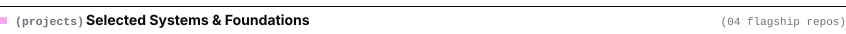
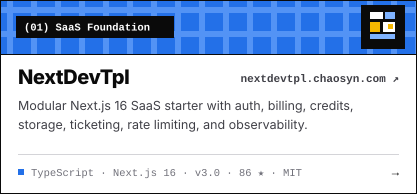
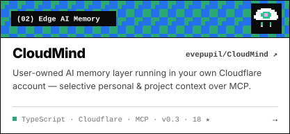
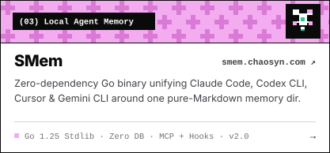
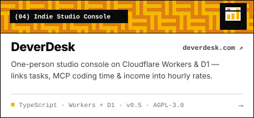
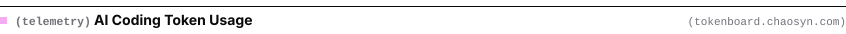

  <a href="https://chaosyn.com">
    <picture>
      <source media="(prefers-color-scheme: dark)" srcset="./assets/hero-dark.svg">
      
    </picture>
  </a>

  <a href="https://chaosyn.com"><picture><source media="(prefers-color-scheme: dark)" srcset="./assets/btn-site-dark.svg"></picture></a>
  <a href="https://blog.chaosyn.com"><picture><source media="(prefers-color-scheme: dark)" srcset="./assets/btn-blog-dark.svg"></picture></a>
  <a href="https://smem.chaosyn.com"><picture><source media="(prefers-color-scheme: dark)" srcset="./assets/btn-smem-dark.svg"></picture></a>
  <a href="https://www.zhihu.com/people/ye-tong-95-79"><picture><source media="(prefers-color-scheme: dark)" srcset="./assets/btn-zhihu-dark.svg"></picture></a>

  <picture>
    <source media="(prefers-color-scheme: dark)" srcset="./assets/sec-work-dark.svg">
    
  </picture>

  <a href="https://github.com/evepupil/NextDevTpl"><picture><source media="(prefers-color-scheme: dark)" srcset="./assets/card-nextdevtpl-dark.svg"></picture></a>&nbsp;<a href="https://github.com/evepupil/CloudMind"><picture><source media="(prefers-color-scheme: dark)" srcset="./assets/card-cloudmind-dark.svg"></picture></a>

  <a href="https://github.com/evepupil/SMem"><picture><source media="(prefers-color-scheme: dark)" srcset="./assets/card-smem-dark.svg"></picture></a>&nbsp;<a href="https://github.com/evepupil/DeverDesk"><picture><source media="(prefers-color-scheme: dark)" srcset="./assets/card-deverdesk-dark.svg"></picture></a>

Live product sites: <a href="https://nextdevtpl.chaosyn.com">nextdevtpl.chaosyn.com</a> · <a href="https://smem.chaosyn.com">smem.chaosyn.com</a> · <a href="https://deverdesk.com">deverdesk.com</a> &nbsp;|&nbsp; Companion tools: <a href="https://github.com/evepupil/TokenBoard">TokenBoard</a> · <a href="https://github.com/evepupil/ccsm">CCSM</a> · <a href="https://github.com/evepupil/DocSeek">DocSeek</a>

  <picture>
    <source media="(prefers-color-scheme: dark)" srcset="./assets/sec-tokens-dark.svg">
    
  </picture>

  

